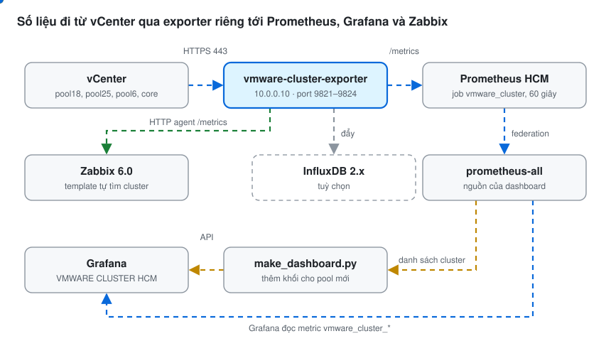

# VMWARE CLUSTER HCM — dashboard lưới ô theo cluster

Dashboard Grafana tổng quan từng cluster VMware: mỗi cluster 1 khối gồm 15 ô màu
(xanh = tốt, cam = cảnh báo, đỏ = lỗi), cố định 4 cột × 4 hàng (ô Cluster Status rộng gấp đôi), 3 cluster / hàng.

## Sơ đồ

<p align="center"></p>

Exporter đăng nhập vCenter bằng user Read-only, mỗi 60 giây lấy số liệu cấp cluster và mở ở `/metrics`.
Prometheus đọc về, prometheus-all lấy lại để Grafana hiển thị; Zabbix đọc thẳng `/metrics`. Khi có pool mới,
`make_dashboard.py` hỏi Prometheus danh sách cluster rồi **chèn thêm khối** cho cluster mới vào dashboard đang có
(giữ nguyên mọi chỉnh sửa tay trên Grafana: tiêu đề, hàng, datasource).

Danh sách cluster nằm trong `CLUSTERS` của `script/make_dashboard.py` (tên đúng như trên vCenter):
`CORE`, `POOL17`, `POOL18-XD`, `POOL23`, `POOL25`, `VC1_POOL6`. POOL23 hiện chưa có trong exporter nào
(9811–9814 chỉ thấy 5 cluster trên) nên khối POOL23 sẽ hiện "–" cho tới khi có vCenter chứa nó.
Thêm pool mới: xem mục **Thêm pool mới khi dashboard đã có** ở cuối.

Bộ này **tách riêng hoàn toàn** khỏi bộ cũ *MONITOR RESOURCE HOST ESXi* (`esxi-host-exporter`):
exporter, service, thư mục, user, port, metric, scrape job và dashboard đều có tên riêng,
cài song song mà không đụng tới exporter cũ đang chạy trên 10.0.0.10.

| | Bộ mới (thư mục này) | Bộ cũ (giữ nguyên) |
|---|---|---|
| Gói cài | `vmware-cluster-exporter-linux.zip` + `.sha256` | `esxi-host-exporter-linux.zip` |
| Service | `vmware-cluster-exporter@<tên>` | `esxi-host-exporter@<tên>` |
| Chương trình / cấu hình | `/opt/vmware-cluster-exporter`, `/etc/vmware-cluster-exporter/` | `/opt/esxi-host-exporter`, `/etc/esxi-host-exporter/` |
| User chạy service | `vmware-cluster` | `esxi-exporter` |
| Port | **9821** pool18 · **9822** pool25 · **9823** pool6 · **9824** core | 9811 · 9812 · 9813 · 9814 |
| Metric | `vmware_cluster_*` | `esxi_host_*`, `esxi_vsan_*`, `vsan_disk_*` |
| Prometheus job | `vmware_cluster` (`vmware-cluster.yml`) | `esxi_host_resource` (`esxi-host-resource.yml`) |
| Dashboard | **VMWARE CLUSTER HCM** (uid `vmware-cluster-hcm`) | MONITOR RESOURCE HOST ESXi |

Exporter mới chỉ lấy số liệu cấp cluster (không lấy disk health, NIC, vmk) nên nhẹ cho vCenter.

```
dashboard-grafana/
  vmware_cluster_hcm_grafana.json          dashboard để import vào Grafana
script/
  vmware-cluster-exporter-linux.zip        gói cài exporter (bản 2026.10.16-4)
  vmware-cluster-exporter-linux.zip.sha256
  make_dashboard.py                        chèn khối pool mới / xoá khối / liệt kê, đẩy lên Grafana
  install_auto_dashboard.sh                cài timer tự thêm khối cho pool mới (mỗi 10 phút)
menu.sh                                    menu quản lý tất cả (sudo bash menu.sh)
zabbix_template_vmware_cluster_hcm.yaml    template Zabbix 6.0
```

## Tải về và chạy nhanh (git clone)

Trên server Linux (server exporter hoặc server Prometheus), cần `git`, `unzip`, `python3`:

```bash
apt install -y git unzip python3          # RHEL/Rocky: dnf install -y git unzip python3
cd /opt && git clone https://github.com/fixnhanh-linux/monitor-grafana-vcenter-total-cluster-prometheus.git
cd monitor-grafana-vcenter-total-cluster-prometheus
```

Không có git: tải zip của repo rồi giải nén:

```bash
curl -L -o repo.zip https://github.com/fixnhanh-linux/monitor-grafana-vcenter-total-cluster-prometheus/archive/refs/heads/main.zip
unzip repo.zip && cd monitor-grafana-vcenter-total-cluster-prometheus-main
```

### Menu (dễ nhất)

Mọi việc gom vào một menu, chọn bằng số:

```bash
sudo bash menu.sh
```

| Số | Việc |
|---|---|
| 1 | Cài exporter cho pool / vCenter mới (tự gợi ý port trống từ 9821) |
| 2 | Xem trạng thái: service, lấy được số liệu chưa, lần lấy gần nhất, cluster của từng pool |
| 3 | Đổi user / mật khẩu vCenter của 1 pool (sai mật khẩu chọn mục này) |
| 4 / 5 / 6 | Khởi động lại – dừng – chạy / xem log / gỡ 1 exporter |
| 7 | In sẵn đoạn `job_name: 'vmware_cluster'` với IP:port các pool trên máy này để dán vào Prometheus |
| 8 | Kiểm tra từng chặng: exporter → Prometheus đã có cluster chưa → Grafana → dashboard |
| 9 | Cài tự động thêm pool lên dashboard (URL Prometheus, Grafana, token, hàng HCM/HN) |
| 10 | Thêm pool mới lên dashboard ngay — **chọn hàng (row)** bằng số; chuyển khối đã có sang hàng khác |
| 11 | Xem các hàng trên dashboard, datasource và cluster từng hàng |
| 12 | Xoá khối 1 cluster khỏi dashboard |
| 13 | Sửa datasource khối hiện `–` (gán đúng Prometheus của site có cluster đó) |
| 14 | Sắp xếp vị trí khối: **kéo thả bằng chuột** (hoặc phím mũi tên), đổi chỗ, đổi hàng — xem sơ đồ trên SSH, lưu mới đổi Grafana |
| 15 | Cập nhật bản mới từ GitHub (giữ cấu hình, mật khẩu) |
| 16 | Gỡ phần tự động dashboard |

Thêm pool mới bằng menu: **1** (cài exporter) → **7** (dán vào Prometheus, reload) → **8** (kiểm tra) → **10** (lên dashboard).
Chi tiết từng mục, câu hỏi và kết quả mẫu: xem **Hướng dẫn dùng menu (chi tiết)** ngay bên dưới.

## Hướng dẫn dùng menu (chi tiết)

Mọi IP, tên máy trong mục này là **giả lập**; thay bằng giá trị thật.

### Mở menu

Chạy trên máy cài exporter (vd `srv-exporter`), cần `git`, `unzip`, `python3`, `curl`:

```bash
cd /opt/monitor-grafana-vcenter-total-cluster-prometheus && git pull && sudo bash menu.sh
```

Không có `sudo` thì menu tự gọi lại bằng `sudo`. Menu tự căn giữa màn hình (cả menu lẫn kết quả từng chức năng),
khung màu, chữ không dấu để hiện đúng trên mọi terminal (MobaXterm, PuTTY…); terminal không hỗ trợ UTF-8 thì
tự chuyển sang khung ASCII `+ = |`:

```text
╔══════════════════════════════════════════════════════════════════╗
║               VMWARE CLUSTER HCM  ●  MONITOR MENU                ║
║            May srv-exporter  ●  IP 10.0.0.10                     ║
╠══════════════════════════════════════════════════════════════════╣
║  Exporter: ● 1/1 Dang Chay        Dashboard Tu Dong: ● Dang Bat  ║
╠══ EXPORTER  -  LAY SO LIEU VCENTER ══════════════════════════════╣
║   [ 1]  Cai Exporter Cho Pool / vCenter Moi                      ║
║   [ 2]  Xem Trang Thai Cac Exporter                              ║
║   [ 3]  Doi User / Mat Khau vCenter Cua 1 Pool                   ║
║   [ 4]  Khoi Dong Lai / Dung / Chay 1 Exporter                   ║
║   [ 5]  Xem Log 1 Exporter                                       ║
║   [ 6]  Go Exporter                                              ║
╠══ PROMETHEUS ════════════════════════════════════════════════════╣
║   [ 7]  In Cau Hinh Prometheus Cho Cac Exporter                  ║
║   [ 8]  Kiem Tra Ket Noi Exporter → Prometheus → Grafana         ║
╠══ DASHBOARD GRAFANA ═════════════════════════════════════════════╣
║   [ 9]  Cai Tu Dong Them Pool Len Dashboard                      ║
║   [10]  Them Pool Moi Len Dashboard Ngay                         ║
║   [11]  Xem Hang Va Cluster Tren Dashboard                       ║
║   [12]  Xoa Khoi 1 Cluster Khoi Dashboard                        ║
║   [13]  Sua Datasource Khoi Hien '-' (Dung Prometheus)           ║
║   [14]  Sap Xep Vi Tri Khoi (Xem Truoc Roi Luu)                  ║
╠══ KHAC ══════════════════════════════════════════════════════════╣
║   [15]  Cap Nhat Ban Moi Tu GitHub                               ║
║   [16]  Go Phan Tu Dong Dashboard                                ║
║   [ 0]  Thoat                                                    ║
╚══════════════════════════════════════════════════════════════════╝
         Ban Quyen © 2026 FIX NHANH  -  License: FIX NHANH
```

Dòng trạng thái: chấm **xanh** = mọi exporter đang chạy / timer dashboard đang bật; chấm **đỏ** = có exporter
dừng, hoặc phần tự động dashboard chưa cài / đang tắt. Gõ số rồi Enter; xong mỗi việc bấm Enter để về menu.

### Quy trình hay dùng

| Muốn | Chọn lần lượt |
|---|---|
| Lần đầu cài trên máy mới | **1** (mỗi vCenter 1 lần) → **7** → dán vào Prometheus → **9** → **8** |
| Thêm pool / vCenter mới | **1** → **7** (dán thêm dòng `- targets`) → **8** → **10** |
| Báo sai mật khẩu, đổi mật khẩu vCenter | **3** → **2** (kiểm tra Up = 1) |
| Ô dashboard hiện `–`, pool không lên | **2** → **8** → làm theo dòng báo vàng/đỏ |
| Khối pool mới hiện `–` (pool thuộc Prometheus site khác) | **13** |
| Pool vào sai hàng (HCM/HN) | **10** → chọn số hàng → nhập tên cluster ở câu "Chuyen cluster DA CO" |
| Đổi thứ tự / vị trí các khối pool | **14** |
| Lấy bản mới | **15** |

### [1] Cài exporter cho pool / vCenter mới

Mỗi vCenter là một *instance* riêng (`vmware-cluster-exporter@<tên>`), 1 port riêng. Menu hỏi:

| Câu hỏi | Nhập | Ghi chú |
|---|---|---|
| Ten instance | `pool5` | chữ, số, `-`, `_`; trùng tên đã có → dùng mục 3 |
| Port metrics | Enter | menu gợi ý port trống đầu tiên từ 9821 |
| IP/hostname vCenter | `10.0.50.10` | |
| User vCenter | `monitor@vsphere.local` | phải có `@vsphere.local` (hoặc domain), quyền **Read-only** là đủ |
| Cluster | Enter (`-`) | `-` = lấy mọi cluster của vCenter |
| Chu ky lay du lieu | Enter (60 giây) | |
| Mat khau vCenter | tự gõ, không hiện | lưu ở `/etc/vmware-cluster-exporter/<tên>.env`, chỉ root đọc |
| URL InfluxDB | Enter | bỏ trống = không đẩy InfluxDB |

Kết quả đúng:

```text
Oct 27 11:20:57 srv-exporter env[218637]: [11:20:57] OK: 1 cluster (0.6s)
OK - exporter dang chay.
   Prometheus : http://10.0.0.10:9821/metrics
Xong. Viec tiep theo: them target 10.0.0.10:9821 vao Prometheus (muc 7).
```

Báo `LOI: dang nhap vCenter that bai (sai user/mat khau)`: exporter **cố ý dừng** (mã 3) để không làm khoá
tài khoản vCenter → chọn **3** nhập lại. Hay sai: thiếu `@vsphere.local`; tài khoản đã bị khoá do nhập sai nhiều lần.

### [2] Xem trạng thái các exporter

```text
Instance   vCenter          Port   Service   Up   Lay luc   Cluster
pool5      10.0.50.10       9821   active    1    12s       POOL5
Tu dong dashboard: timer active, lan chay cuoi:
   Khong co cluster moi (9 cluster tren dashboard) - giu nguyen dashboard
```

| Cột | Ý nghĩa |
|---|---|
| Service | `active` = đang chạy; `failed`/`inactive` = dừng (xem log mục 5) |
| Up | `1` = lần lấy số liệu vCenter gần nhất thành công; `0` = lỗi |
| Lay luc | bao lâu trước lấy được số liệu (bình thường < 2 phút) |
| Cluster | các cluster exporter thấy trên vCenter (tên này sẽ thành khối trên dashboard) |

### [3] Đổi user / mật khẩu vCenter của 1 pool

Chọn pool trong danh sách → Enter giữ user cũ (hoặc gõ user mới) → gõ mật khẩu mới. Menu giữ nguyên IP vCenter,
port, cấu hình InfluxDB; chạy lại exporter và chờ lấy số liệu lần đầu, in `OK - exporter dang chay.` là xong.

### [4] / [5] / [6] Khởi động lại – xem log – gỡ exporter

- **4**: chọn pool → `1` khởi động lại, `2` dừng, `3` chạy.
- **5**: 40 dòng log gần nhất. Dòng tốt: `OK: 1 cluster (0.6s)`. Dòng lỗi hay gặp: `Dang nhap that bai` (mục 3),
  `timed out` / `Connection refused` (máy này không tới được vCenter port 443).
- **6**: `1` gỡ 1 pool (hỏi `y/N`), `2` gỡ **tất cả** (phải gõ `yes`). Gỡ xong nhớ xoá target trong Prometheus.

### [7] In cấu hình Prometheus cho các exporter trên máy

Menu in sẵn đoạn YAML theo IP máy này và port từng pool:

```yaml
  - job_name: 'vmware_cluster'
    scrape_interval: 60s
    scrape_timeout: 30s
    static_configs:
      - targets: ['10.0.0.10:9821']
        labels:
          pool: 'pool5'
```

Trên **server Prometheus** (Prometheus mà datasource của hàng dashboard trỏ tới):

1. `nano /etc/prometheus/prometheus.yml`, dán đoạn trên vào cuối `scrape_configs:`. Dấu `-` của `- job_name`
   phải **thẳng cột** với các `- job_name` khác (YAML lệch 1 dấu cách là lỗi).
2. Đã có job `vmware_cluster` (thêm pool thứ 2 trở đi): **không** dán cả job nữa, chỉ thêm 3 dòng `- targets` /
   `labels` / `pool` vào dưới `static_configs` của job đó.
3. Kiểm tra và nạp lại:

```bash
grep -c "job_name: 'vmware_cluster'" /etc/prometheus/prometheus.yml     # phai la 1
promtool check config /etc/prometheus/prometheus.yml && systemctl reload prometheus
```

4. Mở port trên máy exporter cho Prometheus (menu in sẵn lệnh): `ufw allow from <ip-prometheus> to any port 9821 proto tcp`.
5. Mở `http://<ip-prometheus>:9090/targets`: job `vmware_cluster` phải **UP**.

### [8] Kiểm tra kết nối

Hỏi URL Prometheus (Enter = URL đã lưu ở mục 9) rồi kiểm tra từng chặng:

```text
1) Exporter tren may nay
  pool5 :9821  OK
2) Prometheus http://10.0.0.5:9090
  Ket noi duoc
  Cluster dang co tren Prometheus: "CORE","POOL1-XD","POOL5"
  POOL5 (pool5) da co tren Prometheus
3) Grafana https://10.0.0.7:3000
  Ket noi duoc
4) Dashboard
  Dashboard: VMWARE CLUSTER HCM - HN (uid vmware-cluster-hcm)
  CLUSTER VMWARE HCM   datasource ${datasource}  6 cluster: CORE, POOL17, ...
  CLUSTER VMWARE HN    datasource ab12cd34E      3 cluster: CORE, POOL1-XD, POOL5
  Cluster tren Prometheus chua co tren dashboard: khong co
```

| Báo | Cách xử lý |
|---|---|
| `pool5 :9821 KHONG lay duoc du lieu vCenter` | mục 5 xem log, sai mật khẩu → mục 3 |
| Prometheus `Khong ket noi duoc` | sai IP, hoặc firewall chặn máy này tới port 9090 (không ảnh hưởng exporter, chỉ là không kiểm tra được từ máy này) |
| `POOL5 (pool5) CHUA co` | chưa thêm target / target DOWN → mục 7, mở firewall port exporter |
| Grafana `Khong ket noi duoc` | sai URL, hoặc chứng chỉ https tự ký chưa chọn bỏ qua ở mục 9 |
| `chua co tren dashboard: POOL5` | chọn **10** |

### [9] Cài tự động thêm pool lên dashboard

Cài systemd timer `vmware-cluster-dashboard` chạy mỗi 10 phút: hỏi Prometheus có cluster nào, cluster nào **chưa
có** trên dashboard thì **chèn thêm khối** (không ghi đè dashboard). Câu hỏi:

| Câu hỏi | Nhập | Ghi chú |
|---|---|---|
| URL Prometheus | `http://10.0.0.5:9090` | Prometheus đang scrape các exporter (mục 7) |
| URL Grafana | `https://10.0.0.7:3000` | không có `/` cuối cũng được |
| Chu ky kiem tra | Enter (10 phút) | |
| Grafana service account token | dán token, không hiện | Grafana → Administration → Service accounts → Add (role **Editor**) → Add token |
| Bo qua kiem tra chung chi? | `y` | chỉ hỏi khi Grafana https dùng chứng chỉ tự ký |
| Datasource Prometheus | `Prometheus HCM` | menu liệt kê tên có sẵn; chỉ dùng khi dashboard chưa tồn tại |
| **Chen cluster moi vao hang nao** | `HN` | menu liệt kê các hàng (row); gõ 1 phần tên, Enter = hàng đầu |

Cách chèn khối:

- Khối mới vào **chỗ trống đầu tiên** của hàng đã chọn (3 khối / hàng khối), không đè lên ô nào đang có; hết chỗ
  thì mở hàng khối mới và đẩy các hàng bên dưới xuống. Hàng đang thu gọn cũng chèn được.
- Các ô của khối mới **tự dùng đúng Prometheus có cluster đó**: script hỏi từng datasource Prometheus trên Grafana
  (qua Grafana, bằng token) xem datasource nào có cluster; ưu tiên datasource của hàng, không có thì dùng datasource
  khác có cluster (vd pool5 chỉ có trên Prometheus HN → khối dùng Prometheus HN dù nằm ở hàng HCM).
- Mỗi lần chạy, timer cũng tự sửa khối đang hiện `–` vì datasource không có cluster đó (giống mục 13).
- Giữ nguyên tiêu đề dashboard, các hàng, khối tự sửa tay, thư mục chứa dashboard; ẩn ô chọn datasource ở đầu
  dashboard (giá trị đang chọn giữ nguyên).
- Cluster đã có ở bất kỳ hàng nào thì không thêm lần nữa.

Token lưu ở `/etc/vmware-cluster-dashboard.env` (chỉ root đọc). Chạy lại mục 9 để đổi URL / token / hàng
(Enter ở câu token = giữ token cũ).

### [10] Thêm pool mới lên dashboard ngay (chọn hàng)

Menu in các hàng và cluster đang có (như mục 11), rồi cho **chọn hàng bằng số**:

```text
Chon hang (row) de them khoi:
  1) CLUSTER VMWARE HCM
  2) CLUSTER VMWARE HN
So hang (Enter = hang mac dinh "HN"): 2
-> Them cluster moi vao hang: CLUSTER VMWARE HN
Cluster moi tu Prometheus: POOL5
  + POOL5 -> hang 'CLUSTER VMWARE HN' (x=8, y=41, datasource ab12cd34E = Prometheus HN)
Da day len Grafana: success /d/vmware-cluster-hcm/vmware-cluster-hcm-hn
Chuyen cluster DA CO sang hang 'CLUSTER VMWARE HN'? Nhap ten (vd POOL5, Enter = bo qua):
```

- Cluster có trên Prometheus mà **chưa có** trên dashboard → chèn vào hàng vừa chọn, tự dùng đúng Prometheus
  có cluster đó; đồng thời sửa các khối đang hiện `–` (như mục 13).
- **Chuyển khối đã có** sang hàng vừa chọn (vd POOL5 đang ở hàng HCM → HN): gõ tên cluster ở câu cuối (nhiều tên
  cách nhau dấu cách). Khối cũ được gỡ, khối mới chèn vào chỗ trống của hàng mới.
- Enter ở câu chọn hàng = hàng mặc định đặt ở mục 9 (cũng là hàng timer dùng cho pool mới sau này).

Mở dashboard, bấm F5. Báo `Khong co cluster moi` mà dashboard chưa có pool: Prometheus chưa có cluster đó → mục 8.

### [11] Xem hàng và cluster trên dashboard

In từng hàng (row), datasource và các cluster đang có, cùng cluster có trên Prometheus nhưng chưa có trên dashboard.

### [12] Xoá khối 1 cluster khỏi dashboard

Menu in danh sách (như mục 11) → gõ tên cluster **đúng như trong danh sách** (vd `POOL5`; nhiều tên cách nhau dấu
cách) → xoá thanh tiêu đề + 15 ô của cluster đó, các khối khác giữ nguyên:

```text
Da xoa 16 panel cua: POOL5
Da day len Grafana: success /d/vmware-cluster-hcm/vmware-cluster-hcm-hn
```

Cluster còn trên Prometheus thì timer **tự thêm lại** trong ≤ 10 phút (dùng để thử lại / chuyển sang hàng khác:
mục 12 → mục 9 đổi hàng → mục 10). Muốn bỏ hẳn: xoá target của pool trong Prometheus trước, rồi mục 12.

### [13] Sửa datasource khối hiện `–`

Khối của 1 cluster hiện toàn `–` thường vì ô đang đọc Prometheus của site khác (vd khối POOL5 dùng Prometheus HCM
trong khi POOL5 chỉ có trên Prometheus HN). Mục này kiểm tra từng ô: datasource của ô không có cluster đó mà
datasource Prometheus khác trên Grafana có → đổi sang datasource đó. Ô đang hiện số không bị đụng tới.

```text
Kiem tra datasource tung khoi (o hien '-' vi datasource khong co cluster):
  ~ POOL5: 15 o -> datasource ab12cd34E (Prometheus HN)
Da day len Grafana: success /d/vmware-cluster-hcm/vmware-cluster-hcm-hn
```

Bấm F5 trên dashboard. Báo `Khong co khoi nao can doi datasource` mà vẫn `–`: không datasource nào trên Grafana có
cluster đó → Prometheus chưa scrape pool (mục 7, mục 8), hoặc Grafana chưa có datasource trỏ tới Prometheus đó.

### [14] Sắp xếp vị trí khối — kéo thả bằng chuột (xem trước rồi lưu)

Đổi thứ tự các khối pool ngay trên SSH (MobaXterm, PuTTY, xterm…), không cần mở Grafana. Màn hình vẽ sơ đồ
dashboard, mỗi khối 1 số; mỗi hàng có thêm 1 hàng khối trống ở dưới để thả xuống:

```text
            VMWARE CLUSTER HCM  -  SAP XEP VI TRI KHOI (KEO THA)

  HANG 1: CLUSTER VMWARE HCM
  +-----------------------+-----------------------+-----------------------+
  | 1 CORE                | 2 POOL17              | 3 POOL18-XD           |
  +-----------------------+-----------------------+-----------------------+
  | 4 POOL23              | 5 POOL25              | 6 VC1_POOL6           |
  +-----------------------+-----------------------+-----------------------+
  | 7 POOL5               |                       |                       |
  +-----------------------+-----------------------+-----------------------+
  |                       |                       |                       |
  +-----------------------+-----------------------+-----------------------+
  HANG 2: CLUSTER VMWARE HN
  +-----------------------+-----------------------+-----------------------+
  | 8 POOL1-XD            |                       |                       |
  ...
  CHUOT: bam giu khoi, keo sang o khac roi tha  |  hoac bam khoi roi bam o can toi
  PHIM: Tab chon khoi | mui ten di chuyen | u hoan tac | s luu | q thoat
```

| Thao tác | Việc |
|---|---|
| **Chuột**: bấm giữ khối, kéo sang ô khác, thả | ô trống → khối chuyển tới; ô có khối → 2 khối **đổi chỗ**; thả sang hàng khác → **đổi hàng** (giữ nguyên ô và datasource) |
| **Chuột**: bấm 1 khối (tô xanh), rồi bấm ô cần tới | giống kéo thả |
| `Tab` / `Shift+Tab` | chọn khối kế tiếp / trước |
| Phím mũi tên `↑ ↓ ← →` | đưa khối đang chọn lên / xuống / trái / phải (có khối thì đổi chỗ); `↓` ở dưới cùng hàng → sang **hàng dưới** (vd HCM → HN), `↑` ở hàng khối đầu → sang **hàng trên** |
| `u` | hoàn tác bước vừa làm (làm được nhiều lần) |
| `s` | **lưu**: hỏi `Luu so do nay len dashboard Grafana? (y/n)`, bấm `y` mới đẩy lên Grafana |
| `q` | thoát; đã có thay đổi thì hỏi `Thoat va BO cac thay doi? (y/n)` — dashboard trên Grafana giữ nguyên |

Mọi thao tác chỉ đổi sơ đồ trên SSH; dashboard thật chỉ đổi khi `s` → `y`. Lưu xong bấm F5 trên dashboard.
Ô trống để lại sau khi di chuyển được Grafana tự dồn lên. Hàng đang thu gọn vẫn sắp xếp được.

Chuột không ăn (terminal không hỗ trợ chuột): dùng `Tab` + phím mũi tên, hoặc chế độ gõ lệnh
(`7 w`, `7 4`, `7 h2`, `u`, `l`, `q`) bằng cách mở menu với `sudo ARRANGE_TEXT=1 bash menu.sh`.
MobaXterm: Settings → Terminal → bật *Mouse tracking* nếu đang tắt.

### [15] Cập nhật bản mới từ GitHub

`git pull` → giải nén gói exporter mới → cập nhật script dashboard của timer → chạy lại từng exporter với
**cấu hình và mật khẩu cũ** (không hỏi gì). Mỗi pool in `OK` hoặc 5 dòng lỗi. `git pull loi (co file sua tay?)`:
chạy `git -C /opt/monitor-grafana-vcenter-total-cluster-prometheus status` xem file nào bị sửa trên server.

### [16] Gỡ phần tự động dashboard

Gỡ timer, script và token (`/etc/vmware-cluster-dashboard.env`). Dashboard trên Grafana giữ nguyên.

### Lỗi hay gặp

| Hiện tượng | Nguyên nhân | Xử lý |
|---|---|---|
| `Dang nhap that bai` / Up = 0, service failed mã 3 | sai user / mật khẩu vCenter | mục **3** |
| Mục 9 báo `curl: (28) ... Connection timed out` tới Prometheus | firewall chặn máy này tới port 9090 | dùng IP Prometheus nội bộ, hoặc mở firewall, hoặc cài mục 9 trên chính server Prometheus |
| Mục 9 báo `SSL certificate problem: self-signed certificate` | Grafana https chứng chỉ tự ký | trả lời `y` khi được hỏi (hoặc `sudo GRAFANA_INSECURE=1 bash menu.sh`) |
| Mọi ô dashboard hiện `–` | dashboard đang dùng datasource không có metric `vmware_cluster_*` | Grafana → Explore → chọn datasource → chạy `vmware_cluster_hosts`; dùng datasource có kết quả |
| Khối pool mới hiện `–` | khối đọc Prometheus của site khác | mục **13** (timer cũng tự sửa trong ≤ 10 phút) |
| Pool vừa xoá lại xuất hiện | timer tự thêm cluster còn trên Prometheus | xoá target trong Prometheus trước |
| `bash: http://...: No such file or directory` | dán URL vào terminal như lệnh | dùng `curl -s <url>` |

### Lệnh từng việc

| Việc | Lệnh (trong thư mục repo) |
|---|---|
| Cài exporter (mỗi vCenter chạy 1 lần) | `cd script && sha256sum -c vmware-cluster-exporter-linux.zip.sha256 && unzip -o vmware-cluster-exporter-linux.zip && cd vmware-cluster-exporter && sudo ./install.sh` |
| Thêm job Prometheus | `cp script/vmware-cluster-exporter/prometheus-vmware-cluster.yml /etc/prometheus/scrape_configs/vmware-cluster.yml` (sửa IP/port) |
| Dashboard Grafana | Import `dashboard-grafana/vmware_cluster_hcm_grafana.json` |
| Template Zabbix | Import `zabbix_template_vmware_cluster_hcm.yaml` |
| Tự thêm khối pool mới | `cd script && sudo bash install_auto_dashboard.sh` |

Lấy bản mới về sau này: `git pull` trong thư mục repo, rồi cập nhật exporter theo mục **1b**.

## 1. Cài exporter mới trên server (song song với bộ cũ)

```bash
scp script/vmware-cluster-exporter-linux.zip script/vmware-cluster-exporter-linux.zip.sha256 root@10.0.0.10:/home/
```

Trên server:

```bash
cd /home && sha256sum -c vmware-cluster-exporter-linux.zip.sha256     # phai in ra OK
rm -rf vmware-cluster-exporter && unzip -o vmware-cluster-exporter-linux.zip && cd vmware-cluster-exporter
grep -hE '^(VC|VC_USER|CLUSTER|PORT)=' /etc/esxi-host-exporter/*.env   # xem lai VC/user/cluster cua bo cu (khong in mat khau)
```

Cài 4 instance, mỗi lệnh sẽ hỏi mật khẩu vCenter (bạn tự nhập; điền `VC`/`VC_USER`/`CLUSTER` theo kết quả lệnh grep trên):

```bash
sudo NAME=pool18 VC=10.0.0.20 VC_USER=<user> CLUSTER=- PORT=9821 ./install.sh
sudo NAME=pool25 VC=<vcenter-pool25> VC_USER=<user> CLUSTER=- PORT=9822 ./install.sh
sudo NAME=pool6  VC=<vcenter-pool6>  VC_USER=<user> CLUSTER=- PORT=9823 ./install.sh
sudo NAME=core   VC=<vcenter-core>   VC_USER=<user> CLUSTER=- PORT=9824 ./install.sh
```

Kiểm tra (bộ cũ 9811–9814 vẫn chạy bình thường):

```bash
for p in 9821 9822 9823 9824; do echo -n "$p: "; curl -s localhost:$p/metrics | grep -o 'version="[^"]*"' || echo "CHUA CHAY"; done
curl -s localhost:9821/metrics | grep '^vmware_cluster_hosts'
systemctl status 'esxi-host-exporter@*' --no-pager | grep Active      # bo cu: van active (running)
```

## 2. Thêm scrape job vào Prometheus

```bash
cp prometheus-vmware-cluster.yml /etc/prometheus/scrape_configs/vmware-cluster.yml
promtool check config /etc/prometheus/prometheus.yml && systemctl reload prometheus
```

Nếu `prometheus.yml` liệt kê từng file thay vì `scrape_configs/*.yml`, thêm `vmware-cluster.yml` vào
`scrape_config_files`. Sửa nhãn `site`/`pool` trong file cho giống `esxi-host-resource.yml` nếu cần.

## 1b. Cập nhật exporter khi có bản mới (không cần cài lại, giữ nguyên cấu hình/mật khẩu)

Dễ nhất: `sudo bash menu.sh` → **15**. Làm bằng lệnh (repo clone ở `/opt`):

```bash
cd /opt/monitor-grafana-vcenter-total-cluster-prometheus && git pull && cd script
sha256sum -c vmware-cluster-exporter-linux.zip.sha256 && rm -rf vmware-cluster-exporter && unzip -oq vmware-cluster-exporter-linux.zip
install -m 644 vmware-cluster-exporter/app/vmware_cluster_exporter.py /opt/vmware-cluster-exporter/
systemctl restart 'vmware-cluster-exporter@*' && sleep 10
for f in /etc/vmware-cluster-exporter/*.env; do p=$(sed -n 's/^PORT=//p' "$f"); echo -n "$(basename "$f" .env) :$p  "; curl -s localhost:$p/metrics | grep -o 'version="[^"]*"' || echo "CHUA CHAY"; done
```

Vòng `for` cuối chỉ kiểm tra các pool **cài trên máy này** (đọc port từ `/etc/vmware-cluster-exporter/*.env`).

## 2a. Đẩy thêm lên InfluxDB 2.x (tuỳ chọn)

Exporter vẫn phục vụ `/metrics` cho Prometheus (dashboard đọc từ Prometheus), đồng thời sau mỗi vòng lấy dữ liệu
gửi toàn bộ metric lên InfluxDB: mỗi metric → 1 measurement cùng tên (vd `vmware_cluster_cpu_used_hz`),
nhãn → tag (`cluster`, `vcenter`), giá trị → field `value`, precision giây. Khoảng 20 dòng / cluster / phút.

`install.sh` hỏi URL, org, bucket, token InfluxDB khi cài (Enter ở câu URL = không đẩy). Hoặc bỏ dấu `#` các dòng INFLUX trong `/etc/vmware-cluster-exporter/<instance>.env`, điền token (quyền write bucket),
rồi restart instance. Chạy lại `install.sh` sẽ giữ nguyên các dòng INFLUX đã điền.

```bash
INFLUX_URL='http://10.0.0.x:8086'
INFLUX_ORG='myorg'
INFLUX_BUCKET='vmware'
INFLUX_TOKEN='<token co quyen write bucket>'
```

```bash
systemctl restart vmware-cluster-exporter@pool18
journalctl -u vmware-cluster-exporter@pool18 -f     # phai thay "InfluxDB: da gui ... dong"
```

Lỗi InfluxDB (sai token, mất kết nối…) chỉ ghi log `InfluxDB LOI`, không ảnh hưởng `/metrics`.
Truy vấn mẫu (Flux):
`from(bucket:"vmware") |> range(start:-1h) |> filter(fn:(r)=> r._measurement=="vmware_cluster_hosts" and r.cluster=="POOL17")`.
InfluxDB 1.x: thay 4 dòng trên bằng `INFLUX_URL` + `INFLUX_DB` (+ `INFLUX_USER`, `INFLUX_PASSWORD`).

## 2b. Import dashboard

Grafana → Dashboards → New → Import → upload `dashboard-grafana/vmware_cluster_hcm_grafana.json` → chọn Prometheus → Import.
Dashboard có uid riêng `vmware-cluster-hcm` nên không ghi đè dashboard nào cũ.
Bấm biểu tượng link cạnh tên cluster để mở dashboard **MONITOR RESOURCE HOST ESXi** đã lọc sẵn cluster đó.

Nếu trước đó đã import bản thử "CLUSTER VMWARE HCM" (uid `cluster-vmware-hcm`), có thể xoá bản đó đi.

## 3. Các ô và nguồn số liệu

| Ô | Metric | Màu |
|---|---|---|
| Cluster Status | `vmware_cluster_vsan_health_score` (điểm Skyline Health 0–100, giống "Cluster health score" trên vCenter); không có điểm thì `vmware_cluster_vsan_health`, không có vSAN thì `vmware_cluster_status` | HEALTHY ≥ 80 xanh · WARNING 60–79 cam · ERROR < 60 đỏ |
| DRS | `vmware_cluster_drs_mode` | Manual / Partially / Fully Automated xanh · Tắt cam |
| Total Host | `vmware_cluster_hosts` | xanh |
| Total VM | `vmware_cluster_vms_total` (cả VM đang tắt) | xanh |
| CPU Total | `vmware_cluster_cpu_total_hz` | xanh |
| CPU Used | `cpu_used_hz / cpu_total_hz` | cam ≥ 20% · đỏ ≥ 50% |
| Ram Total | `vmware_cluster_mem_total_bytes` | xanh |
| Ram Used | `mem_used_bytes / mem_total_bytes` | cam ≥ 80% · đỏ ≥ 90% |
| vSAN Total / Free | `vmware_cluster_vsan_capacity_bytes` / `_free_bytes` (vSAN datastore) | xanh |
| vSAN Used | `(capacity − free) / capacity` | cam ≥ 70% · đỏ ≥ 80% |
| vSAN Resync | `vmware_cluster_vsan_resync_bytes` | cam khi > 0 |
| Host - Uptime | `vmware_cluster_host_uptime_max_seconds` (host chạy lâu nhất, ngày) | đỏ ≥ 180 ngày |
| CPU Host (Max) | `vmware_cluster_host_cpu_max_percent` | cam ≥ 30% · đỏ ≥ 35% |
| RAM Host (Max) | `vmware_cluster_host_mem_max_percent` | cam ≥ 76% · đỏ ≥ 80% |

Ngưỡng được suy ra từ màu của dashboard mẫu. Đổi ngưỡng: sửa bảng `THRESHOLDS` trong `script/make_dashboard.py`,
chạy `python3 script/make_dashboard.py`, import lại (Overwrite).

## 4. Khác với dashboard cũ

- **CPU Total** hiển thị đúng đơn vị Hz (vd THz cho cluster lớn); dashboard cũ ghi nhầm GHz.
- **Cluster Status** lấy từ vSAN Skyline Health thật của vCenter (điểm health score), không phải giá trị cố định.

## Zabbix 6.0 — template `VMware Cluster HCM by vmware-cluster-exporter`

File `zabbix_template_vmware_cluster_hcm.yaml`. Zabbix đọc thẳng
`/metrics` của exporter bằng HTTP agent, không cần mật khẩu vCenter trong Zabbix.

1. Configuration → Templates → Import (Zabbix 6.4+: Data collection → Templates) → chọn file YAML → Import.
2. Tạo 4 host (mỗi instance exporter 1 host), interface Agent IP `10.0.0.10`, gắn template, đặt macro `{$VMC.PORT}`:

| Host | `{$VMC.PORT}` | Cluster tự phát hiện |
|---|---|---|
| VMware cluster pool18 | 9821 | POOL17, POOL18-XD |
| VMware cluster pool25 | 9822 | POOL25 |
| VMware cluster pool6 | 9823 | VC1_POOL6 |
| VMware cluster core | 9824 | CORE |

3. Zabbix server (hoặc proxy) phải mở được TCP 9821–9824 tới 10.0.0.10.

Item chính `vmc.metrics` (1 phút, không lưu lịch sử) → các item phụ thuộc; LLD `vmc.cluster.discovery` tạo
19 item + 3 item tính % cho mỗi cluster, 1 graph tài nguyên %.

| Trigger | Mức | Macro (mặc định) |
|---|---|---|
| vSAN health score < ngưỡng | High / Warning | `{$VMC.SCORE.CRIT}` 60 · `{$VMC.SCORE.WARN}` 80 |
| CPU cluster dùng ≥ (min 5 phút) | High / Warning | `{$VMC.CPU.CRIT}` 50 · `{$VMC.CPU.WARN}` 20 |
| RAM cluster dùng ≥ (min 5 phút) | High / Warning | `{$VMC.MEM.CRIT}` 90 · `{$VMC.MEM.WARN}` 80 |
| vSAN đã dùng ≥ | High / Warning | `{$VMC.VSAN.CRIT}` 80 · `{$VMC.VSAN.WARN}` 70 |
| CPU / RAM host cao nhất ≥ (min 5 phút) | Average / Warning | `{$VMC.HOST.CPU.*}` 35/30 · `{$VMC.HOST.MEM.*}` 80/76 |
| vSAN resync kéo dài | Warning | `{$VMC.RESYNC.TIME}` 30m |
| Có host không hoạt động (effective < tổng) | Average | — |
| vCenter báo cluster red | Average | — |
| vSAN Skyline có mục red · DRS tắt · host chạy lâu | Info | `{$VMC.UPTIME.MAX}` 180d |
| Exporter không lấy được dữ liệu vCenter / không đọc được /metrics / số liệu cũ > 10 phút | High / High / Warning | `{$VMC.NODATA}` 5m |

Đổi ngưỡng riêng 1 cluster bằng macro context trên host, ví dụ `{$VMC.HOST.CPU.CRIT:"POOL17"}` = 60.

## Thêm pool mới khi dashboard đã có

Xem từng lệnh và kết quả mẫu ở mục **Ví dụ chi tiết: thêm pool mới POOL30** ngay bên dưới.

Dùng menu thì làm theo **Quy trình hay dùng** ở trên (1 → 7 → 8 → 10); mục này là cách làm bằng lệnh.

Dashboard luôn có uid `vmware-cluster-hcm`. Khi đẩy lên Grafana (`--grafana`) mà dashboard đã có, script **chỉ chèn
khối cho cluster mới** vào chỗ trống của hàng chọn bằng `--row` (mặc định hàng đầu), giữ nguyên mọi chỉnh sửa tay.
`--rebuild` mới sinh lại toàn bộ (mất chỉnh sửa tay). Các tùy chọn khác:

| Tùy chọn | Việc |
|---|---|
| `--row HN` | chèn cluster mới vào hàng có tên chứa `HN`, ô dùng datasource của hàng đó |
| `--list` | in các hàng, datasource, cluster trên dashboard và cluster còn thiếu |
| `--remove POOL5` | xoá khối cluster `POOL5` khỏi dashboard |
| `--move POOL5 --row HN` | chuyển khối `POOL5` sang hàng có tên chứa `HN` |
| `--rows` | in tên các hàng trên dashboard |
| `--arrange` | sắp xếp vị trí khối trên SSH, kéo thả chuột (như mục 14); `ARRANGE_TEXT=1` = chế độ gõ lệnh |
| `--fix-datasource` | khối hiện `–` vì datasource không có cluster → đổi sang Prometheus trên Grafana có cluster đó |
| `--insecure` | Grafana / Prometheus https chứng chỉ tự ký |
| `--datasource <tên>` | datasource dùng khi tạo dashboard mới (chưa có trên Grafana) |
| `--rebuild` | sinh lại toàn bộ dashboard từ đầu |

1. **Cài service exporter cho pool mới** trên server exporter. Mỗi pool (vCenter) là một service riêng
   `vmware-cluster-exporter@<tên>`; `install.sh` tự tạo file cấu hình, bật và chạy service đó, không đụng các pool đang chạy.

```bash
cd /home/vmware-cluster-exporter && ./install.sh
# Ten instance: pool30 | IP vCenter: <ip-vcenter-moi> | User: <user read-only> | Cluster: - | Port: 9825 | mat khau tu go
```

   Script làm lần lượt:

| Việc | Kết quả |
|---|---|
| Ghi cấu hình pool mới | `/etc/vmware-cluster-exporter/pool30.env` (VC, user, port 9825, mật khẩu; chỉ root đọc) |
| Cài / cập nhật unit dùng chung | `/etc/systemd/system/vmware-cluster-exporter@.service` |
| Bật + chạy service pool mới | `systemctl enable --now vmware-cluster-exporter@pool30` |
| Chờ lấy dữ liệu lần đầu | in `OK - exporter dang chay.` |

   Kiểm tra service pool mới và các pool cũ vẫn chạy:

```bash
systemctl status vmware-cluster-exporter@pool30 --no-pager | grep Active      # active (running)
systemctl list-units 'vmware-cluster-exporter@*' --no-legend                    # pool18, pool25, pool6, core, pool30
curl -s localhost:9825/metrics | grep -E 'build_info|^vmware_cluster_hosts'    # co cluster cua pool moi
journalctl -u vmware-cluster-exporter@pool30 -n 20 --no-pager                  # xem log neu loi
```

   Lỗi `Dang nhap that bai` (service dừng, mã 3) = sai user/mật khẩu: chạy lại `./install.sh` với cùng tên `pool30`.
   Không dùng `install.sh` thì làm tay: chép `/etc/vmware-cluster-exporter/pool18.env` thành `pool30.env`, sửa `VC`,
   `VC_USER`, `PORT=9825`, `VC_PASS`, rồi `systemctl enable --now vmware-cluster-exporter@pool30`.

   Sau đó thêm target `<ip-server-exporter>:9825` vào `/etc/prometheus/scrape_configs/vmware-cluster.yml`, reload
   Prometheus, chờ 1–2 phút rồi kiểm tra Prometheus đã có cluster mới:

```bash
curl -s 'http://<ip-prometheus>:9090/api/v1/label/cluster/values?match[]=vmware_cluster_hosts'
```

2. Sinh lại dashboard (máy nào có Python 3 và gọi được Prometheus, trong thư mục repo này):

```bash
python3 script/make_dashboard.py --prometheus http://<ip-prometheus>:9090
```

   Script in `Cluster moi tu Prometheus: <tên>` và ghi đè `dashboard-grafana/vmware_cluster_hcm_grafana.json`.

3. Đưa lên Grafana, chọn 1 trong 2 cách:
   - Import tay: Dashboards → New → Import → upload `dashboard-grafana/vmware_cluster_hcm_grafana.json` →
     **Import (Overwrite)**.
   - Tự đẩy: tạo token ở Administration → Service accounts (role Editor), rồi:

```bash
GRAFANA_TOKEN='<token>' python3 script/make_dashboard.py --prometheus http://<ip-prometheus>:9090 --grafana http://<ip-grafana>:3000
```

   In `Da day len Grafana: success` là xong.

### Tự động: chỉ cần thêm target vào Prometheus

Cài một lần trên máy Linux có Python 3, gọi được Prometheus và Grafana (vd server Prometheus). Script hỏi URL
Prometheus (nguồn của dashboard, vd prometheus-all), URL Grafana và token (role Editor, nhập ẩn), kiểm tra kết nối,
rồi cài systemd timer `vmware-cluster-dashboard` chạy mỗi 10 phút:

```bash
cd script && sudo bash install_auto_dashboard.sh
```

Mỗi lần chạy, timer hỏi Prometheus danh sách cluster; **chỉ khi có cluster chưa có trên dashboard** mới chèn khối
và đẩy lên Grafana (không có gì mới thì bỏ qua). Từ đó thêm pool mới chỉ còn bước 1 (cài exporter + thêm target vào
Prometheus); 10 phút sau dashboard tự có khối mới, ở hàng đã chọn khi cài (câu hỏi "Chen cluster moi vao hang nao").

```bash
journalctl -u vmware-cluster-dashboard.service -n 20     # xem lần chạy gần nhất
systemctl start vmware-cluster-dashboard.service          # chạy ngay, không chờ 10 phút
sudo bash install_auto_dashboard.sh --uninstall           # gỡ timer (dashboard giữ nguyên)
```

Token lưu ở `/etc/vmware-cluster-dashboard.env` (chỉ root đọc được).

Chỉnh sửa tay trên Grafana (đổi tên, thêm hàng, kéo ô, đổi datasource) được giữ nguyên khi timer chèn khối mới.
Zabbix không cần làm gì: template tự phát hiện cluster mới.

## Ví dụ chi tiết: thêm pool mới POOL30 (IP giả lập)

Toàn bộ IP, tên và số liệu trong mục này là **giả lập** để minh hoạ; thay bằng giá trị thật của bạn.

| Máy | IP giả lập | Vai trò |
|---|---|---|
| vCenter mới (chứa cluster POOL30) | `10.0.30.10` | nguồn số liệu |
| Server exporter | `10.0.0.10` | đang chạy 4 instance port 9821–9824, thêm instance `pool30` port **9825** |
| Prometheus HCM | `10.0.0.5:9090` | scrape exporter (job `vmware_cluster`) |
| prometheus-all | `10.0.0.6:9090` | federation, nguồn của dashboard |
| Grafana | `10.0.0.7:3000` | dashboard uid `vmware-cluster-hcm` |
| Zabbix 6.0 | `10.0.0.8` | template `VMware Cluster HCM by vmware-cluster-exporter` |

### Bước 1 — Cài exporter cho vCenter mới (trên server exporter `10.0.0.10`)

Gói đã giải nén ở `/home/vmware-cluster-exporter` từ lần cài trước; chưa có thì chép `script/vmware-cluster-exporter-linux.zip`
lên rồi giải nén như mục 1. Chạy script cài, trả lời như sau (mật khẩu tự gõ, không hiện):

```bash
cd /home/vmware-cluster-exporter && ./install.sh
```

```text
== Cai dat VMware cluster exporter 2026.10.16-4 ==
Ten instance (vd: pool18, chi chu/so/-) [pool18]: pool30
IP/hostname vCenter [10.0.0.20]: 10.0.30.10
User vCenter (chi can quyen Read-only) [monitor@vsphere.local]: monitor@vsphere.local
Cluster (- = tat ca cluster) [-]: -
Port metrics (khac port esxi-host-exporter 9811-9814) [9821]: 9825
Chu ky lay du lieu (giay) [60]:
Mat khau vCenter:
URL InfluxDB 2.x, vd http://10.0.0.x:8086 (Enter = khong day len InfluxDB):
-> Chep chuong trinh vao /opt/vmware-cluster-exporter
-> Kiem tra thu vien pyVmomi
...
OK - exporter dang chay.
   Prometheus : http://10.0.0.10:9825/metrics
```

Kiểm tra port mới (số liệu là ví dụ):

```bash
curl -s localhost:9825/metrics | grep -E 'build_info|^vmware_cluster_hosts|vsan_health_score'
```

```text
vmware_cluster_vsan_health_score{cluster="POOL30"} 97
vmware_cluster_hosts{cluster="POOL30"} 12
vmware_cluster_exporter_build_info{version="2026.10.16-4"} 1
```

Mở firewall nếu Prometheus ở máy khác: `ufw allow 9825/tcp` (hoặc `firewall-cmd --add-port=9825/tcp --permanent && firewall-cmd --reload`).

### Bước 2 — Thêm target vào Prometheus HCM (trên `10.0.0.5`)

Mở `/etc/prometheus/scrape_configs/vmware-cluster.yml`, thêm 2 dòng cuối:

```yaml
scrape_configs:
  - job_name: vmware_cluster
    scrape_interval: 60s
    scrape_timeout: 30s
    static_configs:
      - targets: ['10.0.0.10:9821']
        labels: {site: HCM, pool: pool18}
      - targets: ['10.0.0.10:9822']
        labels: {site: HCM, pool: pool25}
      - targets: ['10.0.0.10:9823']
        labels: {site: HCM, pool: pool6}
      - targets: ['10.0.0.10:9824']
        labels: {site: HCM, pool: core}
      - targets: ['10.0.0.10:9825']          # pool moi
        labels: {site: HCM, pool: pool30}
```

```bash
promtool check config /etc/prometheus/prometheus.yml && systemctl reload prometheus
curl -s 'http://10.0.0.5:9090/api/v1/targets?state=active' | grep -o '"scrapeUrl":"http://10.0.0.10:9825[^"]*"[^}]*"health":"[a-z]*"'
```

```text
SUCCESS: /etc/prometheus/prometheus.yml is valid prometheus config file syntax
"scrapeUrl":"http://10.0.0.10:9825/metrics", ... "health":"up"
```

### Bước 3 — Kiểm tra prometheus-all đã thấy POOL30 (chờ 1–2 phút)

Federation đã lấy mọi metric `vmware_cluster_.*` nên không sửa gì trên prometheus-all.

```bash
curl -s 'http://10.0.0.6:9090/api/v1/label/cluster/values?match[]=vmware_cluster_hosts'
```

```text
{"status":"success","data":["CORE","POOL17","POOL18-XD","POOL25","POOL30","VC1_POOL6"]}
```

### Bước 4 — Dashboard tự có khối POOL30

**Đã cài timer** (`install_auto_dashboard.sh`): không cần làm gì, tối đa 10 phút. Muốn chạy ngay:

```bash
systemctl start vmware-cluster-dashboard.service
journalctl -u vmware-cluster-dashboard.service -n 5 --no-pager
```

```text
Cluster moi tu Prometheus: POOL30
  + POOL30 -> hang 'VMWARE CLUSTER HCM' (x=0, y=27, datasource ${datasource})
Da ghi /var/lib/vmware-cluster-dashboard/vmware_cluster_hcm_grafana.json - 7 cluster
Da day len Grafana: success /d/vmware-cluster-hcm/vmware-cluster-hcm
```

**Chưa cài timer**: chạy tay trong thư mục repo (token Grafana role Editor):

```bash
GRAFANA_TOKEN='<token>' python3 script/make_dashboard.py --prometheus http://10.0.0.6:9090 --grafana http://10.0.0.7:3000
```

Mở `http://10.0.0.7:3000/d/vmware-cluster-hcm`: khối POOL30 nằm ở hàng thứ 3, cột đầu (3 cluster / hàng, cluster mới
thêm vào cuối):

```text
| CORE      | POOL17    | POOL18-XD |
| POOL23    | POOL25    | VC1_POOL6 |
| POOL30    |           |           |
```

### Bước 5 — Thêm host trong Zabbix (`10.0.0.8`)

Configuration → Hosts → mở host `VMware cluster pool18` → **Full clone**:

| Ô | Giá trị |
|---|---|
| Host name | `VMware cluster pool30` |
| Interfaces → Agent | IP `10.0.0.10` (giữ nguyên) |
| Macros → `{$VMC.PORT}` | `9825` |

Bấm **Add**. Sau 1–2 phút, Monitoring → Latest data lọc host `VMware cluster pool30` phải thấy
`Exporter: vCenter collection = OK` và các item `Cluster POOL30: ...` (template tự tìm cluster).

### Kiểm tra nhanh toàn bộ

| Kiểm tra | Kết quả đúng |
|---|---|
| `curl -s 10.0.0.10:9825/metrics \| grep build_info` | `version="2026.10.16-4"` |
| Prometheus HCM → Status → Targets | `10.0.0.10:9825` **UP** |
| prometheus-all label values | có `"POOL30"` |
| Grafana dashboard | có khối POOL30, 15 ô có số |
| Zabbix Latest data | host pool30 có item `Cluster POOL30: ...` |
