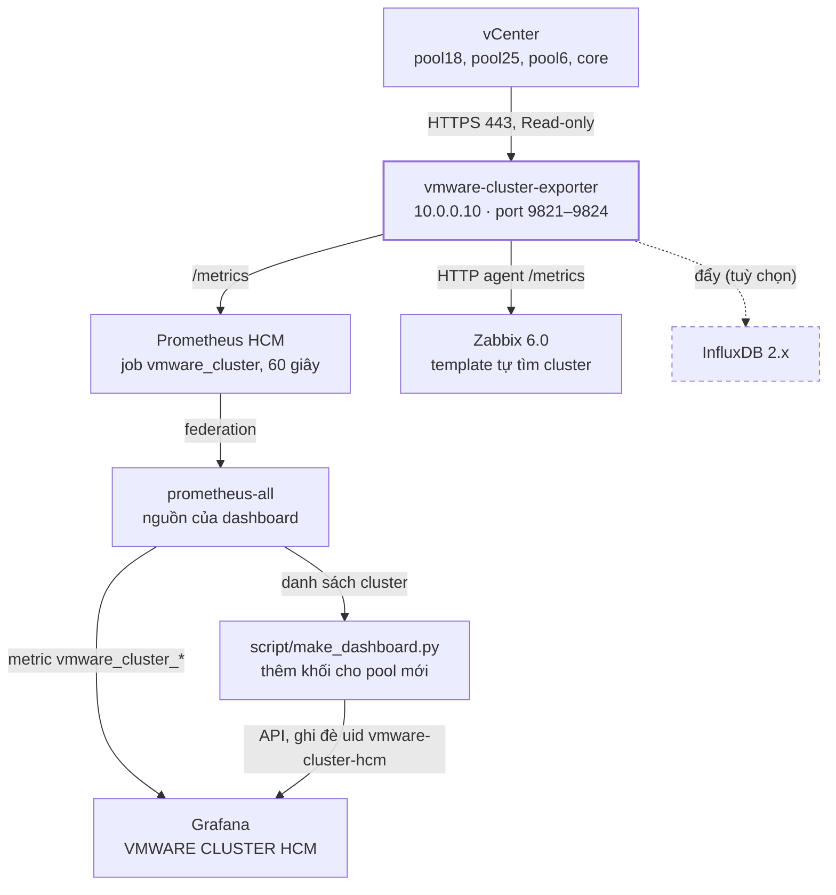

# VMWARE CLUSTER HCM — dashboard lưới ô theo cluster

Dashboard Grafana tổng quan từng cluster VMware: mỗi cluster 1 khối gồm 15 ô màu
(xanh = tốt, cam = cảnh báo, đỏ = lỗi), cố định 4 cột × 4 hàng (ô Cluster Status rộng gấp đôi), 3 cluster / hàng.

## Sơ đồ



Exporter đăng nhập vCenter bằng user Read-only, mỗi 60 giây lấy số liệu cấp cluster và mở ở `/metrics`.
Prometheus đọc về, prometheus-all lấy lại để Grafana hiển thị; Zabbix đọc thẳng `/metrics`. Khi có pool mới,
`make_dashboard.py` hỏi prometheus-all danh sách cluster rồi ghi đè dashboard để thêm khối mới.

Danh sách cluster nằm trong `CLUSTERS` của `script/make_dashboard.py` (tên đúng như trên vCenter):
`CORE`, `POOL17`, `POOL18-XD`, `POOL23`, `POOL25`, `VC1_POOL6`. POOL23 hiện chưa có trong exporter nào
(9811–9814 chỉ thấy 5 cluster trên) nên khối POOL23 sẽ hiện "–" cho tới khi có vCenter chứa nó.
Thêm pool mới: xem mục **Thêm pool mới khi dashboard đã có** ở cuối.

Bộ này **tách riêng hoàn toàn** khỏi bộ cũ *MONITOR RESOURCE HOST ESXi* (`esxi-host-exporter`):
exporter, service, thư mục, user, port, metric, scrape job và dashboard đều có tên riêng,
cài song song mà không đụng tới exporter cũ đang chạy trên 10.0.0.10.

| | Bộ mới (thư mục này) | Bộ cũ (giữ nguyên) |
|---|---|---|
| Gói cài | `vmware-cluster-exporter-linux.zip` + `.sha256` | `esxi-host-exporter-linux.zip` |
| Service | `vmware-cluster-exporter@<tên>` | `esxi-host-exporter@<tên>` |
| Chương trình / cấu hình | `/opt/vmware-cluster-exporter`, `/etc/vmware-cluster-exporter/` | `/opt/esxi-host-exporter`, `/etc/esxi-host-exporter/` |
| User chạy service | `vmware-cluster` | `esxi-exporter` |
| Port | **9821** pool18 · **9822** pool25 · **9823** pool6 · **9824** core | 9811 · 9812 · 9813 · 9814 |
| Metric | `vmware_cluster_*` | `esxi_host_*`, `esxi_vsan_*`, `vsan_disk_*` |
| Prometheus job | `vmware_cluster` (`vmware-cluster.yml`) | `esxi_host_resource` (`esxi-host-resource.yml`) |
| Dashboard | **VMWARE CLUSTER HCM** (uid `vmware-cluster-hcm`) | MONITOR RESOURCE HOST ESXi |

Exporter mới chỉ lấy số liệu cấp cluster (không lấy disk health, NIC, vmk) nên nhẹ cho vCenter.

```
dashboard-grafana/
  vmware_cluster_hcm_grafana.json          dashboard để import vào Grafana
script/
  vmware-cluster-exporter-linux.zip        gói cài exporter (bản 2026.10.16-4)
  vmware-cluster-exporter-linux.zip.sha256
  make_dashboard.py                        sinh lại dashboard, tự thêm pool mới, đẩy lên Grafana
zabbix_template_vmware_cluster_hcm.yaml    template Zabbix 6.0
```

## 1. Cài exporter mới trên server (song song với bộ cũ)

```bash
scp script/vmware-cluster-exporter-linux.zip script/vmware-cluster-exporter-linux.zip.sha256 root@10.0.0.10:/home/
```

Trên server:

```bash
cd /home && sha256sum -c vmware-cluster-exporter-linux.zip.sha256     # phai in ra OK
rm -rf vmware-cluster-exporter && unzip -o vmware-cluster-exporter-linux.zip && cd vmware-cluster-exporter
grep -hE '^(VC|VC_USER|CLUSTER|PORT)=' /etc/esxi-host-exporter/*.env   # xem lai VC/user/cluster cua bo cu (khong in mat khau)
```

Cài 4 instance, mỗi lệnh sẽ hỏi mật khẩu vCenter (bạn tự nhập; điền `VC`/`VC_USER`/`CLUSTER` theo kết quả lệnh grep trên):

```bash
sudo NAME=pool18 VC=10.0.0.20 VC_USER=<user> CLUSTER=- PORT=9821 ./install.sh
sudo NAME=pool25 VC=<vcenter-pool25> VC_USER=<user> CLUSTER=- PORT=9822 ./install.sh
sudo NAME=pool6  VC=<vcenter-pool6>  VC_USER=<user> CLUSTER=- PORT=9823 ./install.sh
sudo NAME=core   VC=<vcenter-core>   VC_USER=<user> CLUSTER=- PORT=9824 ./install.sh
```

Kiểm tra (bộ cũ 9811–9814 vẫn chạy bình thường):

```bash
for p in 9821 9822 9823 9824; do echo -n "$p: "; curl -s localhost:$p/metrics | grep -o 'version="[^"]*"' || echo "CHUA CHAY"; done
curl -s localhost:9821/metrics | grep '^vmware_cluster_hosts'
systemctl status 'esxi-host-exporter@*' --no-pager | grep Active      # bo cu: van active (running)
```

## 2. Thêm scrape job vào Prometheus

```bash
cp prometheus-vmware-cluster.yml /etc/prometheus/scrape_configs/vmware-cluster.yml
promtool check config /etc/prometheus/prometheus.yml && systemctl reload prometheus
```

Nếu `prometheus.yml` liệt kê từng file thay vì `scrape_configs/*.yml`, thêm `vmware-cluster.yml` vào
`scrape_config_files`. Sửa nhãn `site`/`pool` trong file cho giống `esxi-host-resource.yml` nếu cần.

## 1b. Cập nhật exporter khi có bản mới (không cần cài lại, giữ nguyên cấu hình/mật khẩu)

```bash
cd /home && sha256sum -c vmware-cluster-exporter-linux.zip.sha256 && rm -rf vmware-cluster-exporter && unzip -o vmware-cluster-exporter-linux.zip
install -m 644 vmware-cluster-exporter/app/vmware_cluster_exporter.py /opt/vmware-cluster-exporter/
systemctl restart 'vmware-cluster-exporter@*'
for p in 9821 9822 9823 9824; do echo -n "$p: "; curl -s localhost:$p/metrics | grep -o 'version="[^"]*"' || echo "CHUA CHAY"; done
```

## 2a. Đẩy thêm lên InfluxDB 2.x (tuỳ chọn)

Exporter vẫn phục vụ `/metrics` cho Prometheus (dashboard đọc từ Prometheus), đồng thời sau mỗi vòng lấy dữ liệu
gửi toàn bộ metric lên InfluxDB: mỗi metric → 1 measurement cùng tên (vd `vmware_cluster_cpu_used_hz`),
nhãn → tag (`cluster`, `vcenter`), giá trị → field `value`, precision giây. Khoảng 20 dòng / cluster / phút.

`install.sh` hỏi URL, org, bucket, token InfluxDB khi cài (Enter ở câu URL = không đẩy). Hoặc bỏ dấu `#` các dòng INFLUX trong `/etc/vmware-cluster-exporter/<instance>.env`, điền token (quyền write bucket),
rồi restart instance. Chạy lại `install.sh` sẽ giữ nguyên các dòng INFLUX đã điền.

```bash
INFLUX_URL='http://10.0.0.x:8086'
INFLUX_ORG='myorg'
INFLUX_BUCKET='vmware'
INFLUX_TOKEN='<token co quyen write bucket>'
```

```bash
systemctl restart vmware-cluster-exporter@pool18
journalctl -u vmware-cluster-exporter@pool18 -f     # phai thay "InfluxDB: da gui ... dong"
```

Lỗi InfluxDB (sai token, mất kết nối…) chỉ ghi log `InfluxDB LOI`, không ảnh hưởng `/metrics`.
Truy vấn mẫu (Flux):
`from(bucket:"vmware") |> range(start:-1h) |> filter(fn:(r)=> r._measurement=="vmware_cluster_hosts" and r.cluster=="POOL17")`.
InfluxDB 1.x: thay 4 dòng trên bằng `INFLUX_URL` + `INFLUX_DB` (+ `INFLUX_USER`, `INFLUX_PASSWORD`).

## 2b. Import dashboard

Grafana → Dashboards → New → Import → upload `dashboard-grafana/vmware_cluster_hcm_grafana.json` → chọn Prometheus → Import.
Dashboard có uid riêng `vmware-cluster-hcm` nên không ghi đè dashboard nào cũ.
Bấm biểu tượng link cạnh tên cluster để mở dashboard **MONITOR RESOURCE HOST ESXi** đã lọc sẵn cluster đó.

Nếu trước đó đã import bản thử "CLUSTER VMWARE HCM" (uid `cluster-vmware-hcm`), có thể xoá bản đó đi.

## 3. Các ô và nguồn số liệu

| Ô | Metric | Màu |
|---|---|---|
| Cluster Status | `vmware_cluster_vsan_health_score` (điểm Skyline Health 0–100, giống "Cluster health score" trên vCenter); không có điểm thì `vmware_cluster_vsan_health`, không có vSAN thì `vmware_cluster_status` | HEALTHY ≥ 80 xanh · WARNING 60–79 cam · ERROR < 60 đỏ |
| DRS | `vmware_cluster_drs_mode` | Manual / Partially / Fully Automated xanh · Tắt cam |
| Total Host | `vmware_cluster_hosts` | xanh |
| Total VM | `vmware_cluster_vms_total` (cả VM đang tắt) | xanh |
| CPU Total | `vmware_cluster_cpu_total_hz` | xanh |
| CPU Used | `cpu_used_hz / cpu_total_hz` | cam ≥ 20% · đỏ ≥ 50% |
| Ram Total | `vmware_cluster_mem_total_bytes` | xanh |
| Ram Used | `mem_used_bytes / mem_total_bytes` | cam ≥ 80% · đỏ ≥ 90% |
| vSAN Total / Free | `vmware_cluster_vsan_capacity_bytes` / `_free_bytes` (vSAN datastore) | xanh |
| vSAN Used | `(capacity − free) / capacity` | cam ≥ 70% · đỏ ≥ 80% |
| vSAN Resync | `vmware_cluster_vsan_resync_bytes` | cam khi > 0 |
| Host - Uptime | `vmware_cluster_host_uptime_max_seconds` (host chạy lâu nhất, ngày) | đỏ ≥ 180 ngày |
| CPU Host (Max) | `vmware_cluster_host_cpu_max_percent` | cam ≥ 30% · đỏ ≥ 35% |
| RAM Host (Max) | `vmware_cluster_host_mem_max_percent` | cam ≥ 76% · đỏ ≥ 80% |

Ngưỡng được suy ra từ màu của dashboard mẫu. Đổi ngưỡng: sửa bảng `THRESHOLDS` trong `script/make_dashboard.py`,
chạy `python3 script/make_dashboard.py`, import lại (Overwrite).

## 4. Khác với dashboard cũ

- **CPU Total** hiển thị đúng đơn vị Hz (vd THz cho cluster lớn); dashboard cũ ghi nhầm GHz.
- **Cluster Status** lấy từ vSAN Skyline Health thật của vCenter (điểm health score), không phải giá trị cố định.

## Zabbix 6.0 — template `VMware Cluster HCM by vmware-cluster-exporter`

File `zabbix_template_vmware_cluster_hcm.yaml`. Zabbix đọc thẳng
`/metrics` của exporter bằng HTTP agent, không cần mật khẩu vCenter trong Zabbix.

1. Configuration → Templates → Import (Zabbix 6.4+: Data collection → Templates) → chọn file YAML → Import.
2. Tạo 4 host (mỗi instance exporter 1 host), interface Agent IP `10.0.0.10`, gắn template, đặt macro `{$VMC.PORT}`:

| Host | `{$VMC.PORT}` | Cluster tự phát hiện |
|---|---|---|
| VMware cluster pool18 | 9821 | POOL17, POOL18-XD |
| VMware cluster pool25 | 9822 | POOL25 |
| VMware cluster pool6 | 9823 | VC1_POOL6 |
| VMware cluster core | 9824 | CORE |

3. Zabbix server (hoặc proxy) phải mở được TCP 9821–9824 tới 10.0.0.10.

Item chính `vmc.metrics` (1 phút, không lưu lịch sử) → các item phụ thuộc; LLD `vmc.cluster.discovery` tạo
19 item + 3 item tính % cho mỗi cluster, 1 graph tài nguyên %.

| Trigger | Mức | Macro (mặc định) |
|---|---|---|
| vSAN health score < ngưỡng | High / Warning | `{$VMC.SCORE.CRIT}` 60 · `{$VMC.SCORE.WARN}` 80 |
| CPU cluster dùng ≥ (min 5 phút) | High / Warning | `{$VMC.CPU.CRIT}` 50 · `{$VMC.CPU.WARN}` 20 |
| RAM cluster dùng ≥ (min 5 phút) | High / Warning | `{$VMC.MEM.CRIT}` 90 · `{$VMC.MEM.WARN}` 80 |
| vSAN đã dùng ≥ | High / Warning | `{$VMC.VSAN.CRIT}` 80 · `{$VMC.VSAN.WARN}` 70 |
| CPU / RAM host cao nhất ≥ (min 5 phút) | Average / Warning | `{$VMC.HOST.CPU.*}` 35/30 · `{$VMC.HOST.MEM.*}` 80/76 |
| vSAN resync kéo dài | Warning | `{$VMC.RESYNC.TIME}` 30m |
| Có host không hoạt động (effective < tổng) | Average | — |
| vCenter báo cluster red | Average | — |
| vSAN Skyline có mục red · DRS tắt · host chạy lâu | Info | `{$VMC.UPTIME.MAX}` 180d |
| Exporter không lấy được dữ liệu vCenter / không đọc được /metrics / số liệu cũ > 10 phút | High / High / Warning | `{$VMC.NODATA}` 5m |

Đổi ngưỡng riêng 1 cluster bằng macro context trên host, ví dụ `{$VMC.HOST.CPU.CRIT:"POOL17"}` = 60.

## Thêm pool mới khi dashboard đã có

Dashboard luôn có uid `vmware-cluster-hcm`. Sinh lại rồi import (Overwrite) hoặc đẩy lên sẽ **cập nhật đúng dashboard
đang có** (không tạo bản mới): các khối cũ giữ nguyên chỗ, pool mới thêm một khối 15 ô ở cuối, 3 cluster / hàng.

1. Cài exporter cho vCenter mới trên server (`./install.sh` trong gói, port tiếp theo, vd 9825), thêm target
   `<ip>:9825` vào `/etc/prometheus/scrape_configs/vmware-cluster.yml`, reload Prometheus. Chờ 1–2 phút rồi kiểm tra
   Prometheus đã có cluster mới:

```bash
curl -s 'http://<ip-prometheus>:9090/api/v1/label/cluster/values?match[]=vmware_cluster_hosts'
```

2. Sinh lại dashboard (máy nào có Python 3 và gọi được Prometheus, trong thư mục repo này):

```bash
python3 script/make_dashboard.py --prometheus http://<ip-prometheus>:9090
```

   Script in `Cluster moi tu Prometheus: <tên>` và ghi đè `dashboard-grafana/vmware_cluster_hcm_grafana.json`.

3. Đưa lên Grafana, chọn 1 trong 2 cách:
   - Import tay: Dashboards → New → Import → upload `dashboard-grafana/vmware_cluster_hcm_grafana.json` →
     **Import (Overwrite)**.
   - Tự đẩy: tạo token ở Administration → Service accounts (role Editor), rồi:

```bash
GRAFANA_TOKEN='<token>' python3 script/make_dashboard.py --prometheus http://<ip-prometheus>:9090 --grafana http://<ip-grafana>:3000
```

   In `Da day len Grafana: success` là xong. Đặt cron chạy lệnh này 30 phút một lần thì pool mới tự hiện.

Lưu ý: cập nhật sẽ ghi đè dashboard, chỉnh sửa tay trên Grafana (đổi tên, kéo ô) sẽ mất; muốn đổi thì sửa
`script/make_dashboard.py`. Pool mới được thêm vào lần chạy hiện tại; muốn giữ cố định thứ tự thì thêm tên vào
`CLUSTERS`. Zabbix không cần làm gì: template tự phát hiện cluster mới.
